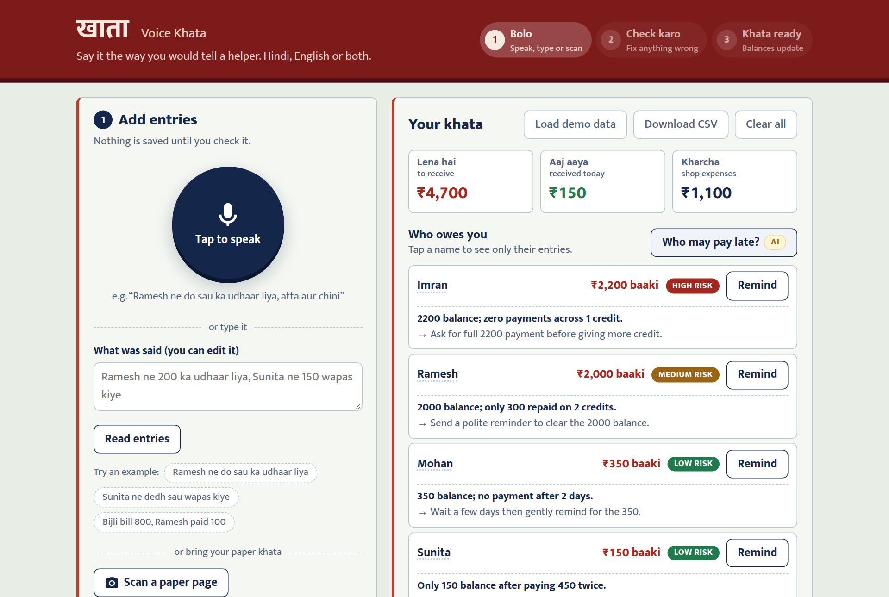
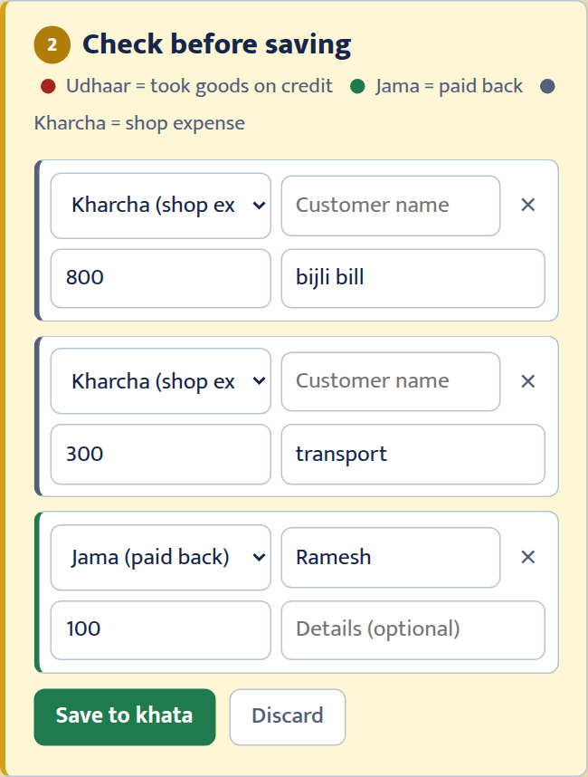
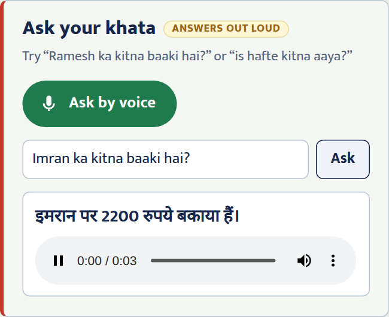
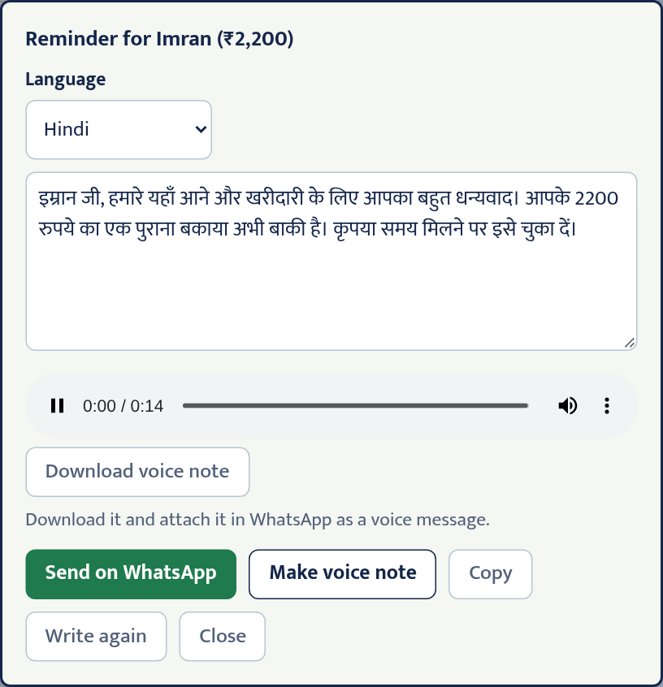
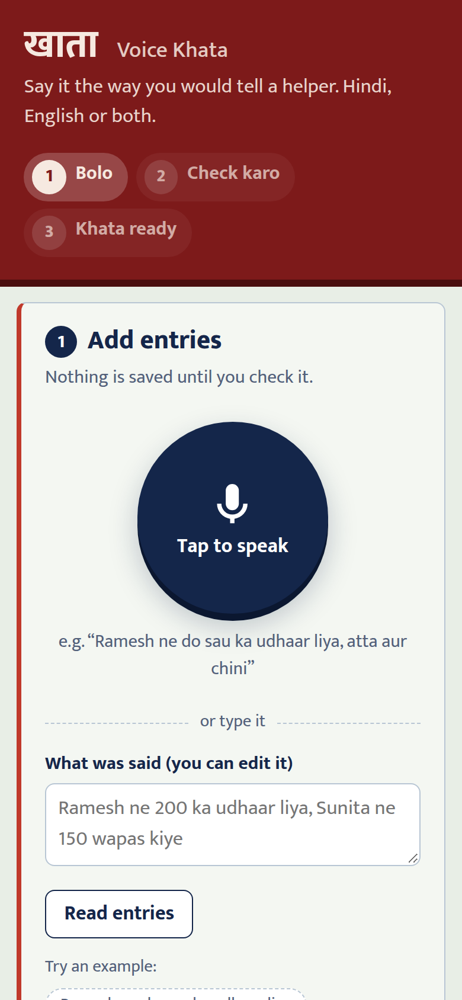

# Voice Khata (खाता)

**Speak your udhaar and expenses in Hindi, English or any Indian language. Get a running khata.**

**Live demo:** https://voice-khata-sarvam.vercel.app (press **Load demo data** to try it with sample customers)

Built for the Sarvam AI Buildathon.

## Problem

A kirana shopkeeper records udhaar (credit) in a paper bahi-khata while serving customers. Writing is slow, names are spelled differently each time, and chasing pending payments is awkward. Speaking is the natural way to record it.

## What it does

A **khata** (bahi-khata) is the notebook a shopkeeper keeps to track money: who took goods on credit (**udhaar**), who paid back (**jama**) and what the shop spent (**kharcha**). Voice Khata keeps that book for you.


- **Talk to your khata, hands-free:** tap once and have a conversation. Say entries, correct them ("nahi, 250 tha"), say "haan" to save, ask questions, and say "bas" to stop. It listens, works out what you mean, answers out loud and listens again, with about 2 seconds per reply.
- **Speak an entry**, e.g. *"Ramesh ne do sau ka udhaar liya, atta aur chini"*. It becomes a structured entry (name, amount, udhaar / jama / kharcha, note), and you check it before saving.
- **See the khata**: who owes what, today's collections and shop expenses.
- **Ask your khata out loud**, e.g. *"Ramesh ka kitna baaki hai?"*, and hear the answer in Hindi.
- **Send reminders** as a polite WhatsApp message or a voice note, in Hindi, Hinglish or English.
- **Who may pay late?** marks each customer as low, medium or high risk from their payment history and suggests a respectful nudge.
- **Scan a paper page** of an old bahi-khata to bring it into the app.
- **Many languages:** speak in any of 22 Indian languages or English, even mixed. Spoken answers and reminders come back in your choice of Hindi, English, Bengali, Marathi, Tamil, Telugu, Kannada, Malayalam, Gujarati, Punjabi or Odia.

## Screenshots



| Check before saving | Ask your khata (spoken answer) |
|---|---|
|  |  |

| Reminder with voice note | On a phone |
|---|---|
|  |  |

## Sarvam AI models used

| Model | Used for |
|---|---|
| Saaras v4 | Speech to text in 22 Indian languages + English, biased toward known customer names |
| Sarvam 105B | Understanding entries, answering questions, reminders, risk insights |
| Sarvam 105B Conversations | The hands-free voice agent: decides whether you're adding, correcting, confirming or asking, and writes the spoken reply |
| Bulbul v3 | Speaking answers and reminder voice notes in 11 languages |
| Document AI | Reading photos of paper ledger pages |

## Run locally

```bash
npm install
cp .env.example .env      # add your SARVAM_API_KEY
npm start
```

Open http://localhost:3000.
